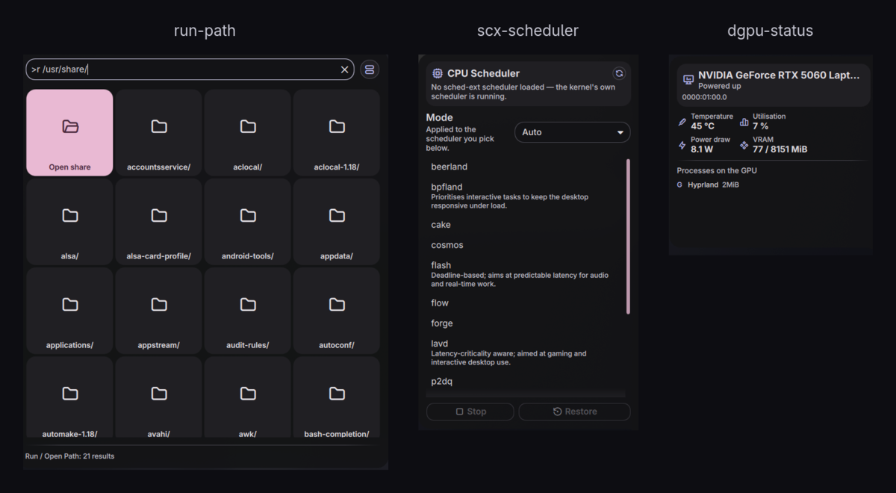
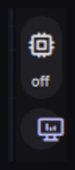

# noctalia-plugins

Three plugins for [Noctalia Shell](https://github.com/noctalia-dev/noctalia-shell) — a launcher
mode that opens filesystem paths, a sched-ext CPU scheduler switcher, and a discrete-GPU monitor
that never wakes a sleeping GPU.



| Plugin | What it does |
|---|---|
| [`run-path`](run-path/) | Type a path in the launcher to open it, with live completion — or type anything else to run it |
| [`scx-scheduler`](scx-scheduler/) | Switch [sched-ext](https://github.com/sched-ext/scx) CPU schedulers from the bar |
| [`dgpu-status`](dgpu-status/) | dGPU power state and stats, read without ever resuming a suspended GPU |

Each folder has its own README with install steps, keybinds and design notes.

## Install

Clone anywhere and symlink the plugins you want into Noctalia's plugin directory:

```fish
git clone https://github.com/Zyrecx/noctalia-plugins.git ~/src/noctalia-plugins

ln -s ~/src/noctalia-plugins/run-path      ~/.config/noctalia/plugins/run-path
ln -s ~/src/noctalia-plugins/scx-scheduler ~/.config/noctalia/plugins/scx-scheduler
ln -s ~/src/noctalia-plugins/dgpu-status   ~/.config/noctalia/plugins/dgpu-status
```

Symlinks work because the shell enumerates plugins with `for d in .../*/` plus a `[ -d "$d" ]`
test, both of which follow symlinks. Copying the directories instead works equally well.

**A shell restart is required after adding a plugin directory.**
`PluginRegistry.scanPluginFolder()` runs only at startup, and nothing in the UI rescans the folder —
the refresh button on the Installed tab checks the plugin registry for updates, not the disk:

```fish
qs kill -c noctalia-shell; sleep 1; qs -c noctalia-shell -d
```

A newly discovered plugin defaults to **disabled**, so nothing loads until you switch it on in
**Settings → Plugins → Installed**. `scx-scheduler` and `dgpu-status` then need their widget added
in **Settings → Bar**.

To remove one: `rm ~/.config/noctalia/plugins/<name>` — that deletes the symlink only.

## Requirements

Noctalia Shell 4.1.2 or newer (developed against 4.7.7) on Quickshell. Beyond that, each plugin
needs only what it actually talks to:

| Plugin | Needs |
|---|---|
| `run-path` | nothing beyond a file manager (`xdg-open` by default) |
| `scx-scheduler` | `scx-tools` with the `scx_loader` service, and a polkit agent |
| `dgpu-status` | an NVIDIA dGPU using runtime PM; `nvidia-smi` for the detailed stats |

Keybinds are compositor-level. The examples are Hyprland syntax because that is what these were
written on; the IPC calls behind them work under any compositor.

## Bar widgets

`scx-scheduler` and `dgpu-status` each add a bar capsule — the scheduler's short name (`off` when
none is loaded) and the GPU's state, tinted while it is awake:



## Status

Verified on the machine these were written for (CachyOS + Hyprland, RTX 5060 Max-Q + AMD iGPU):
all three plugins load with no errors, the bar widgets and panels render, `dgpu-status` auto-detects
the GPU at `0000:01:00.0`, scheduler switching works through the panel, and `run-path` opens and
completes paths from its keybind.

Verified by other means: every shell command each plugin runs (executed directly), the output
parsers (a standalone JS harness, including a synthetic `nvidia-smi` process table and names
containing spaces and commas), and QML syntax via `qmllint`.

Not verified: any machine other than that one. In particular `dgpu-status` assumes a single NVIDIA
dGPU with runtime PM enabled, and `scx-scheduler` assumes the D-Bus interface of a current
`scx_loader`. Both are version 0.1.0 — treat them accordingly.

## Developing

Turn on debug mode in Noctalia's settings and `PluginService` will watch each plugin directory and
hot-reload on save. Two caveats:

- The watcher relies on inotify. On filesystems where that doesn't fire (an `ntfs3` mount, for
  instance), saves won't trigger a reload — toggle the plugin off and on in Settings instead.
- Hot reload re-instantiates entry points; it does not re-read `manifest.json` defaults into an
  existing `settings.json`. After changing `metadata.defaultSettings`, delete
  `~/.config/noctalia/plugins/<name>/settings.json` and reload.

For linting, use the **Qt 6** binary explicitly:

```fish
/usr/lib/qt6/bin/qmllint -I /etc/xdg/quickshell/noctalia-shell **/*.qml
```

On distributions that ship `qt5-declarative`, plain `qmllint` on `$PATH` is Qt 5's, which rejects
Qt 6 QML syntax and exits non-zero while printing nothing at all — an easy way to believe you have
a syntax error when you don't, or to believe you've linted when you haven't.

Even the Qt 6 one cannot resolve the `qs.*` imports (the shell ships no `qmldir` files), so expect
`Failed to import qs.Commons` warnings and a few cascading false positives from them. It won't
catch a misspelled `Style.` token either — those only show up at runtime in the shell's log.

## House rules these follow

Taken from the shell's own plugin contracts and the `clipboard` reference plugin:

- Every `pluginApi` access is optional-chained; the shell injects it *after* instantiation.
- `??` fallbacks in `Settings.qml` are byte-identical to `metadata.defaultSettings` in the manifest.
- `Component.onDestruction` stops every `Process` so a shell reload leaves no orphans.
- Process output is read in `onExited` from a named `StdioCollector`, never from `this` inside
  `onStreamFinished` — the two signals have no guaranteed ordering.
- A revision counter is bumped on in-place array mutations, and consumers read it inside bindings,
  because QML does not re-evaluate bindings when an array is mutated in place.
- Bar widgets declare `property ShellScreen screen` with the type, and pass themselves as the
  `caller` to `openPanel(screen, this)` so the panel anchors to the widget instead of drifting to
  screen centre.

## License

MIT — see [LICENSE](LICENSE).
