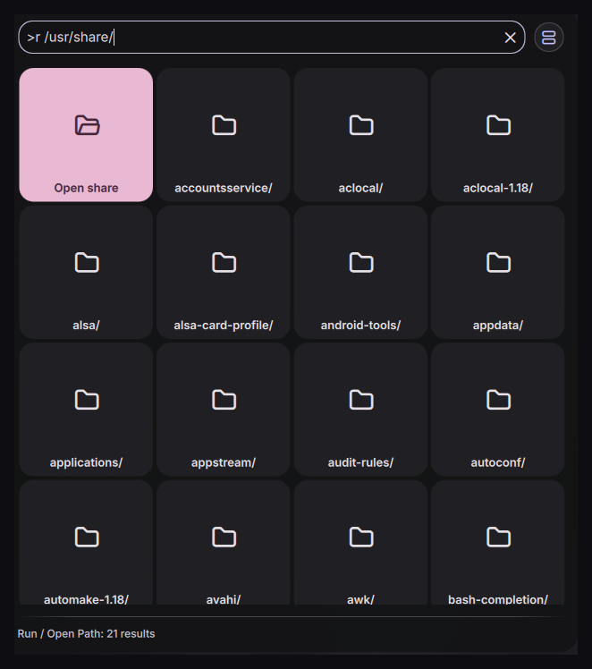

# run-path

A "run or open" prompt built on Noctalia's own launcher.

Type a path and it completes as you type; Enter opens it in your file manager. Type anything that
isn't a path and Enter runs it as a command. Both live behind the launcher prefix `>r `, so it also
works by opening the launcher normally and typing `>r`.



```
>r ~/Doc          →  Documents/            (completion)
>r ~/Documents    →  Open Documents        (Enter → file manager)
>r /etc/fstab     →  Open fstab            (Enter → default handler)
>r btop           →  Run: btop             (Enter → sh -c btop)
```

## Install

```fish
ln -s ~/src/noctalia-plugins/run-path ~/.config/noctalia/plugins/run-path
```

Restart the shell (`qs kill -c noctalia-shell; sleep 1; qs -c noctalia-shell -d`), then enable the
plugin in Settings → Plugins → Installed.

## Keybind

A Wayland shell cannot register a global hotkey — the compositor owns them — so the keybind lives
in your compositor config and calls the plugin over IPC. For Hyprland:

```
bind = SUPER, R, exec, qs -c noctalia-shell ipc call plugin:run-path toggle
```

`toggle` opens the launcher already in `>r ` mode, and closes it if it is already in that mode.
`open` is the same without the closing half, for a bind that might repeat.

`openAt` starts you in a specific directory, which is worth a second bind if you always land in the
same place:

```
bind = SUPER SHIFT, R, exec, qs -c noctalia-shell ipc call plugin:run-path openAt ~/Projects
```

Since the keybind is set outside the plugin, the plugin can't know what it is. Whatever you type in
**Keybind hint** in the plugin's settings is what gets shown next to `>r` in the launcher's command
list, so the binding is discoverable from inside the UI. The Settings page also shows the exact
`bind` line to copy.

## Behaviour details

- **Enter opens what you typed.** The first row is always "Open ⟨what the path resolves to⟩", and
  the launcher preselects the first row — so typing a directory and hitting Enter opens it.
- **Clicking a folder in the list descends** into it (it rewrites the search text) rather than
  opening it. That way the list doubles as navigation without a second keybind.
- `~` expands to your home directory. `.` and `..` resolve **against your home directory**, not a
  current working directory — a launcher doesn't have one.
- Path mode is chosen when the input starts with `/`, `~` or `.`. Everything else is a command.
- An empty input lists your home directory, so the keybind on its own is still useful.

## Settings

- **File manager** — command used for directories. Defaults to `xdg-open`, which follows the
  desktop default. Set it to `nautilus`, `thunar`, `dolphin` … to skip the indirection.
- **File opener** — command used for files. Also `xdg-open` by default.
- **Show hidden files** — include dotfiles in completion.
- **Maximum results** — completion entries listed at once (default 20).
- **Keybind hint** — text shown beside `>r` in the launcher command list.

## How it works

`LauncherCore` calls `getResults()` synchronously on every keystroke, so directory listings can't be
fetched inline. `ls` runs in a background `Process`, results are cached per directory for 4 seconds,
and when a listing lands the provider calls `launcher.updateResults()` to re-query itself. Directory
entries keep the trailing `/` that `ls -p` adds, which is also how a typed path is classified as a
file or a directory without spawning a second `stat`.

`openAt` reaches `PanelService.openLauncherWithSearch()` directly, because `pluginApi` exposes
`openLauncher` but nothing that opens it pre-filled.

## Known limitations

- No fuzzy matching inside a directory — completion is prefix-based (case-insensitive). Fuzzy
  matching via `FuzzySort` would be a small change if you want it.
- Commands run detached via `sh -c` with no terminal. A "run in terminal" toggle would need a
  terminal command setting; not implemented in v1.
- Paths containing a literal `~` other than at the start are not un-expanded.
