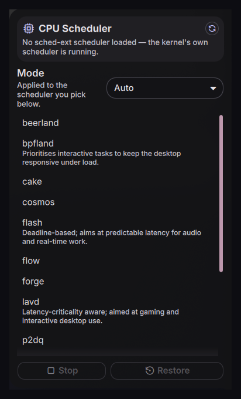

# scx-scheduler

Switch [sched-ext](https://github.com/sched-ext/scx) CPU schedulers from the Noctalia bar.

`sched_ext` is a kernel framework that lets a CPU scheduler be loaded as a BPF program while the
system runs — no reboot, no kernel parameter. Distributions like CachyOS ship the whole `scx` suite,
so the machine has a dozen alternative schedulers installed that are normally only reachable from a
terminal. This plugin puts them one click away: it shows which scheduler is loaded, lets you start,
switch, stop or restore one, and picks the mode (`auto`, `gaming`, `lowlatency`, `powersave`,
`server`) it runs in.



## Do you need this?

Probably not, and that's worth saying plainly. The kernel's own EEVDF scheduler is good, and on a
normal desktop workload you will not feel the difference. sched-ext is interesting when you have a
*specific* complaint:

| Symptom | Worth trying |
|---|---|
| Frame stutter in games while something compiles in the background | `scx_lavd` in `gaming` mode |
| Desktop goes sluggish under heavy parallel builds | `scx_bpfland` |
| Audio/DAW xruns under load | `scx_flash` |
| Long batch/server workloads, throughput over responsiveness | `scx_rusty`, or `scx_tickless` |

The honest usage pattern is: leave it off, and when something feels wrong, switch, test the thing
that felt wrong, and switch back if it didn't help. `Stop` returns you to the kernel's scheduler
instantly. Nothing here survives a reboot unless you configure it to (see
[Persistence](#persistence)).

## Requirements

- `scx-tools` installed and the `scx_loader` service available:
  ```
  systemctl status scx_loader
  ```
  It is D-Bus activated, so it does not need to be enabled to work from this panel.
- A polkit authentication agent, for the password prompt when switching (see below).

Reading state needs no authentication at all — the D-Bus policy allows `Properties.Get` for
everyone, so the bar widget costs nothing.

## Install

```fish
ln -s ~/src/noctalia-plugins/scx-scheduler ~/.config/noctalia/plugins/scx-scheduler
```

Restart the shell (`qs kill -c noctalia-shell; sleep 1; qs -c noctalia-shell -d`), enable the plugin
in Settings → Plugins → Installed, then add the widget in Settings → Bar.

## The password prompt

Switching is gated by the polkit action `org.scx.loader.manage-schedulers`, whose default policy is
`auth_admin_keep`. In principle the "keep" caches your answer for the session; in practice each
`scxctl` invocation is a fresh short-lived process, so the prompt tends to come back on **every**
switch — which rather defeats a one-click toggle.

If that bothers you, [`49-scx-loader-nopasswd.rules`](49-scx-loader-nopasswd.rules) in this
directory grants members of the `wheel` group passwordless access to the scheduler methods:

```fish
pkexec install -m 0644 -o root -g root \
  ~/src/noctalia-plugins/scx-scheduler/49-scx-loader-nopasswd.rules \
  /etc/polkit-1/rules.d/49-scx-loader-nopasswd.rules
```

It takes effect immediately — polkit watches `rules.d`. What it grants is bounded: `scx_loader`
only launches schedulers from its own compiled-in list, so this is not arbitrary code execution.
The one caveat is that the `*WithArgs` D-Bus methods let a caller pass arbitrary command-line
arguments to those fixed scheduler binaries. On a single-user machine that is a reasonable trade;
on a shared one, narrow the rule from the `wheel` group to your own username — the file has a
commented example. Leaving the default policy alone is also a perfectly good answer if you switch
schedulers rarely.

## Keybinds

```
# Open/close the panel
bind = SUPER, S, exec, qs -c noctalia-shell ipc call plugin:scx-scheduler toggle

# Jump straight to a scheduler, no UI
bind = SUPER SHIFT, G, exec, qs -c noctalia-shell ipc call plugin:scx-scheduler switchTo scx_lavd gaming
bind = SUPER SHIFT, S, exec, qs -c noctalia-shell ipc call plugin:scx-scheduler stop
```

`qs -c noctalia-shell ipc call plugin:scx-scheduler status` prints the current state as JSON, which
is handy for scripts.

## How it works

Reads and writes deliberately use different backends:

| | backend | why |
|---|---|---|
| read state | `busctl get-property org.scx.Loader …` | structured JSON, never prompts for auth |
| read mode name | `scxctl get` | the `SchedulerMode` D-Bus property is a bare `uint` whose numeric mapping isn't documented on disk, so the name is parsed from `scxctl` instead of guessed |
| start/switch/stop/restore | `scxctl` | already knows the mode-name → enum mapping, and handles the polkit round-trip |

Every action re-reads the real state when it finishes, so a cancelled authentication prompt leaves
the UI showing what is actually loaded rather than what you asked for. Failures surface on the
error line at the bottom of the panel.

## Persistence

Switching a scheduler from this panel lasts until you stop it or reboot — nothing here writes
config. `scx_loader.service` is D-Bus activated and ships disabled, and there is typically no
`/etc/scx_loader.toml`, in which case `DefaultScheduler` reads `unknown` and the **Restore** button
is greyed out (its tooltip says why).

To make one load at boot, create `/etc/scx_loader.toml`:

```toml
default_sched = "scx_lavd"
default_mode = "Auto"
```

and `systemctl enable --now scx_loader`. Restore then becomes useful, and the panel picks the
default up on its next refresh.

## Settings

- **Show scheduler name in the bar** — icon only, or icon + `lavd`.
- **Label when stopped** — what the bar shows when no sched-ext scheduler is loaded. Defaults to
  `off`, which is short enough to survive a vertical bar; longer strings get elided there.
- **Default mode** — pre-selected mode when the panel opens.
- **Refresh interval** — 2–60 s.

Bar text/icon colours are read from `activeColor` / `textColor` / `iconColor` in `settings.json` but
have no UI yet; edit the file directly if you want to change them.

## Known limitations

- Polls instead of subscribing to `PropertiesChanged`. The signal exists (all the properties are
  `emits-change`) and would remove the poll entirely — good v2 change.
- Scheduler descriptions in the panel only cover the six schedulers whose purpose is well
  established upstream. The rest render without a subtitle rather than with an invented one.
